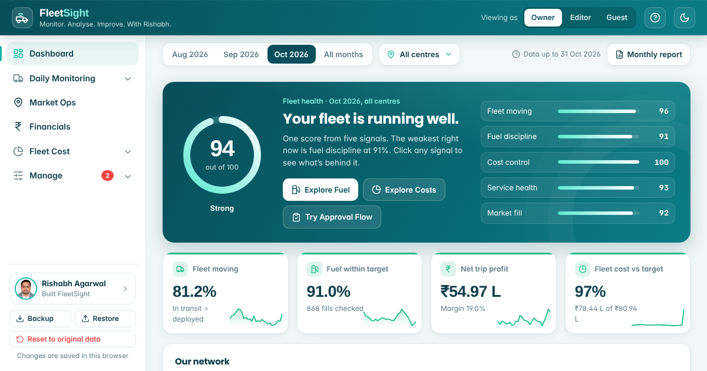

# FleetSight — Monitor. Analyse. Improve.

A fleet operations and cost intelligence platform for a network of **7 centres, 250 vehicles and 40 clients** across East and North-East India — built as a single, fast web app with an assistant that answers questions and cites its sources.

**Live demo:** [fleetsight-rishabh.web.app](https://fleetsight-rishabh.web.app) &nbsp;·&nbsp; **Built by** [Rishabh Agarwal](https://www.linkedin.com/in/iimrishabh-agarwal/)



> All company names, clients, vehicles and figures in FleetSight are illustrative.

---

## The problem
Fleet businesses run on scattered spreadsheets: daily truck running, diesel slips, repair bills, market bookings and trip profit all live in different places. Managers see numbers late, and rarely see *why* they moved.

## What FleetSight does
| Area | What you can do |
|---|---|
| **Dashboard** | One fleet-health score from five signals, headline cards with trends, an India network map, and a "needs attention" list |
| **Daily Monitoring** | Daily truck running by centre (with automatic checks), diesel by lane against its own target, repair and maintenance pace |
| **Market Ops** | Bookings vs placements by state, detention, month pace vs target |
| **Financials** | Trip profitability from revenue to net profit, profit by segment, client margins |
| **Fleet Cost** | Every cost head vs monthly target with a daily pace tracker, preventive maintenance plan |
| **Vehicle 360** | Click any vehicle code anywhere to see its trips, diesel, service, costs and profit |
| **Ask FleetSight** | Plain-English questions answered from live data tools and 17 company documents, with sources and a step-by-step trace |
| **Reports** | One-page monthly management report as PDF, and Excel export on every table |
| **Data entry** | Spreadsheet-style sheets with typed and calculated cells, monthly target matrices |
| **Roles** | Owner / Editor / Guest, with guest changes held for approval |

Also: guided tour for first-time visitors, dark mode, theme colours, backup and restore, works on phones, and can be installed as an app.

## How it is built
- **Front end:** React (no build step), Recharts for charts, htm for templates, hand-written CSS with design tokens
- **Map:** India state boundaries projected to SVG with a Mercator formula; animated lanes and live centre markers
- **Assistant:** BM25 retrieval over a document knowledge base, rule-based tool calling over live data, cited answers — runs fully in the browser
- **Reports:** jsPDF and SheetJS, loaded only when needed
- **Storage:** browser localStorage with JSON backup and restore
- **Hosting:** Firebase Hosting with security headers and an offline-ready service worker

## What I learned
- Designing for decisions: every chart ends with a plain-English "what this means"
- How retrieval-augmented assistants work: chunking, ranking, citations and honest "I don't know" answers
- Turning geography into an interactive map without a map provider
- Keeping a public demo safe: no secrets in the code, security headers, and a deploy guard

## Screenshots
| | |
|---|---|
| _Dashboard and network map_ | _Ask FleetSight_ |
| _Vehicle 360_ | _Monthly report (PDF)_ |

## Project structure
```
public/          The live site (index.html, icons, manifest, service worker)
source/src/      Readable source files that make up index.html
source/build.js  Rebuilds public/index.html from the source:  node source/build.js
scripts/guard.js Safety check that runs before every deploy
firebase.json    Hosting settings and security headers
```

## Credits
India boundaries: [DataMeet India community](https://github.com/datameet/maps), CC BY 4.0. Libraries: React, Recharts, htm, jsPDF, SheetJS.
